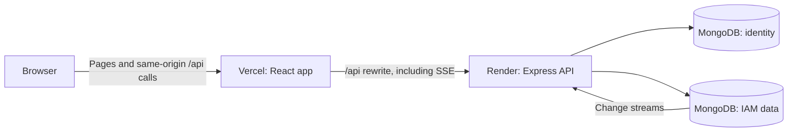

# IAMScope

IAMScope helps a team understand the effect of an IAM policy change. Edit a policy, evaluate access, and inspect the result through three connected views:

| View         | Question it answers                                                 |
| ------------ | ------------------------------------------------------------------- |
| **Impact**   | Which saved access scenarios changed between evaluation runs?       |
| **Graph**    | Could a principal gain more access through an escalation path?      |
| **Timeline** | What did the organization's IAM state look like at an earlier time? |

The app is multi-tenant: each organization has its own policies, principals, resources, scenarios, and audit history. The [product plan](Plan.txt) contains the full specification; this README is the practical guide to running and deploying the code.

## Try the deployed app

- Web app: [ia-mscope.vercel.app](https://ia-mscope.vercel.app/)
- API health: [iamscope-api.onrender.com/api/health](https://iamscope-api.onrender.com/api/health)

Version `v1.0.0` is tagged. Automated API and deployment checks passed at release. Browser interaction, accessibility, Lighthouse, and the Vercel and cron dashboard checks are explicitly deferred in [DECISIONS.md](DECISIONS.md#v100-release-scope); they are not claimed as verified.

## How it fits together



Vercel forwards `/api/*` to Render. The browser therefore calls one origin, which lets the session cookie work for normal requests and the live event stream. MongoDB needs a **replica set** because the API uses change streams.

## Run locally

You need **Node.js 20+**, npm, and Docker with Compose. From the repository root:

```bash
npm ci
npm run build:packages
docker compose up -d --wait mongo
npm run seed
npm run dev
```

Open [http://localhost:3000](http://localhost:3000). The API runs at [http://localhost:4000/api/health](http://localhost:4000/api/health). `npm run dev` starts MongoDB, the API, and the web app; the MongoDB command above makes sure the replica set is ready before seeding. Stop the development servers with Ctrl+C and stop MongoDB with `docker compose down`.

The seed can be rerun without duplicating its records. It creates the **Acme Cloud** demo organization, sample IAM data, and these development accounts:

| Role  | Email                  | Development password |
| ----- | ---------------------- | -------------------- |
| Owner | `demo@iamscope.dev`    | `iamscope-demo-2026` |
| Admin | `analyst@iamscope.dev` | `iamscope-demo-2026` |

For a production seed, set `IAM_DEMO_PASSWORD` to a unique value of at least 16 characters **before the first seed**. The production seed requires it, and rerunning the seed does not change an existing user's password. The development password above should not be treated as a production credential.

### Configuration

The local backend works with its built-in development defaults and the Compose replica set. It reads **process environment variables directly**; copying [`backend/.env.example`](backend/.env.example) by itself does not load that file. Use the example as a list of settings to supply through your shell or hosting dashboard. The [frontend example](frontend/.env.example) is a template; Vite loads a `frontend/.env` file if you create one.

| Setting                         | Purpose                                                                                    |
| ------------------------------- | ------------------------------------------------------------------------------------------ |
| `MONGO_IDENTITY_URL`            | Connection to the `iamscope_identity` database: users, orgs, sessions, and API keys        |
| `MONGO_DATA_URL`                | Connection to the `iamscope_data` database: IAM records, evaluations, presence, and audit  |
| `SESSION_SECRET`, `CSRF_SECRET` | Separate secrets, each at least 16 characters; required in production                      |
| `CORS_ORIGIN`                   | Allowed browser origin; `https://ia-mscope.vercel.app` in production                       |
| `VITE_API_URL`                  | Leave empty or unset for same-origin `/api` calls through the Vite proxy or Vercel rewrite |

Other options, including cookie policy, session idle timeout, logging, and the alternate SSE transport, are documented in the two `.env.example` files. Keep real credentials out of Git; `.env` files are ignored.

## Useful commands

| Command                | What it does                                                  |
| ---------------------- | ------------------------------------------------------------- |
| `npm run dev`          | Start local MongoDB, API, and web app                         |
| `npm run seed`         | Add the demo organization and IAM data                        |
| `npm run build`        | Build shared packages, backend, and frontend                  |
| `npm run typecheck`    | Typecheck all workspaces                                      |
| `npm run lint`         | Run ESLint with zero warnings allowed                         |
| `npm run format:check` | Check formatting with Prettier                                |
| `npm test`             | Run backend and frontend tests                                |
| `npm run smoke`        | Test the compiled app against a temporary MongoDB replica set |

Run `npm run build` before `npm run smoke`: smoke starts `backend/dist/index.js`, the same compiled entry point used in production. It checks auth, invitations, role permissions, CRUD for all four IAM record types, evaluation, the three views' API data, API keys, audit, and SSE. Its MongoDB and API are temporary, so a smoke pass does **not** prove the hosted deployment works.

## Deployment

| Service       | Configuration                                  | Responsibility                                    |
| ------------- | ---------------------------------------------- | ------------------------------------------------- |
| MongoDB Atlas | Two databases on a replica-set cluster         | Identity and IAM data                             |
| Render        | [`render.yaml`](render.yaml)                   | Build and run the backend; expose `/api/health`   |
| Vercel        | [`frontend/vercel.json`](frontend/vercel.json) | Build the frontend and rewrite `/api/*` to Render |

Render reads the database URLs, `CORS_ORIGIN`, and secrets from its environment. `render.yaml` pins Node 20, enables automatic deployment from `main`, and builds shared packages before the backend. Vercel should build the `frontend` project with Vite and output `dist`. Leave `VITE_API_URL` empty or unset in production so requests use the rewrite; keep `COOKIE_SAMESITE=lax` on Render.

A cron-job.org job can request `https://iamscope-api.onrender.com/api/health` every ten minutes to reduce cold starts on Render's free plan. Its schedule and delivery history still need a signed-in dashboard check; see the [release scope](DECISIONS.md#v100-release-scope).

To check the **deployed** API, frontend, login flow, and live event delivery:

```powershell
npm run deploy:check -- --api https://iamscope-api.onrender.com --web https://ia-mscope.vercel.app
```

This command uses the demo login by default. If its deployed password differs, supply `DEPLOY_EMAIL` and `DEPLOY_PASSWORD` in your shell. The options after `--` are passed to the checker, not consumed by npm. See [`scripts/deploy-handoff.md`](scripts/deploy-handoff.md) for the detailed deployment runbook.

## Repository map

| Path               | Contents                                                            |
| ------------------ | ------------------------------------------------------------------- |
| `packages/types`   | Shared API and domain types                                         |
| `packages/schemas` | Shared Zod validation schemas                                       |
| `packages/tokens`  | Design tokens                                                       |
| `backend`          | Express API, authentication, MongoDB services, and evaluation logic |
| `frontend`         | React and Vite app, including Impact, Graph, and Timeline           |
| `scripts`          | Smoke, deployed-stack, and SSE load checks                          |

Policy edits create immutable policy versions and audit events. Evaluations and caches update from those changes; tenant identity comes from the session or API key rather than a client-supplied `orgId`. The trade-offs behind these choices are recorded in [DECISIONS.md](DECISIONS.md).
